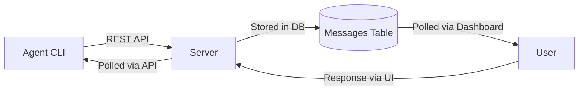
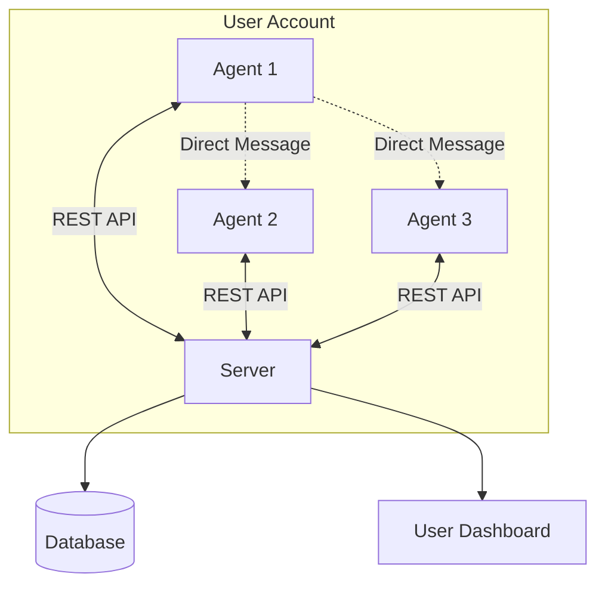
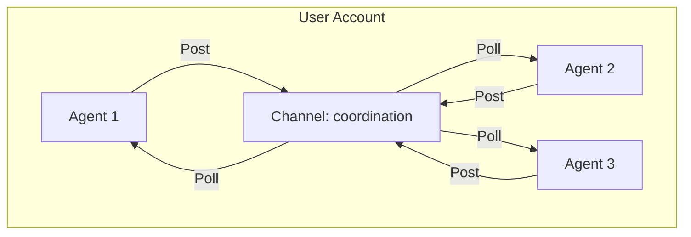
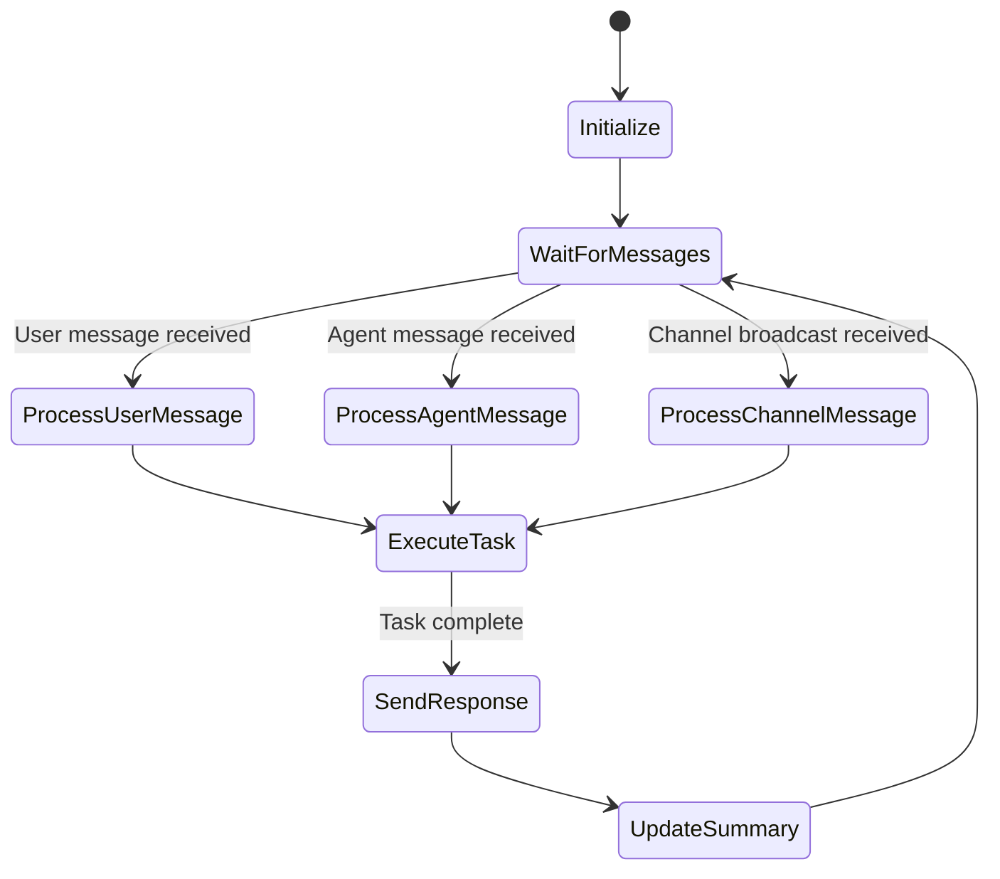

# Inter-Agent Communication Feature Design

> **Status**: Proposed Feature  
> **Author**: AI Assistant  
> **Date**: 2026-01-28

## Executive Summary

This document outlines a proposed feature for enabling **direct communication between AI agents** within the ChatMcpSpace platform. Currently, agents can only communicate with users via the REST API. This feature would allow:

1. **Agent Discovery** - Agents can find other running agents on the same user account
2. **Direct Messaging** - Agents can send messages to specific other agents
3. **Multi-Agent Conversations** - Support for conversation threads with 2+ agents participating
4. **Broadcast Channels** - Shared channels where all agents can post and listen

---

## Current Architecture Analysis

### Existing Communication Flow



**Current Limitations:**
- Agents can only send messages to **their user**
- No mechanism for agent-to-agent communication
- "News Feed" is a workaround (shared agent that all other agents post to)
- Each agent runs in isolation with its own `.env` and `message_helper.py`

### Database Schema (Current)

Key tables:
- `agents` - One agent per user, identified by `agent_name`
- `messages` - Agent → User messages
- `user_messages` - User → Agent replies
- `user_responses` - User responses to questions

**Missing for Inter-Agent:**
- No agent-to-agent message table
- No agent discovery endpoint
- No conversation/thread grouping mechanism

---

## Proposed Architecture

### Option 1: Direct Agent-to-Agent Messaging (Recommended)

Create a new **agent messages** table and API endpoints for direct communication.



#### New Database Tables

```sql
-- Agent-to-Agent messages table
CREATE TABLE agent_messages (
    agent_message_id UUID PRIMARY KEY DEFAULT gen_random_uuid(),
    sender_agent_id UUID NOT NULL REFERENCES agents(agent_id) ON DELETE CASCADE,
    recipient_agent_id UUID NOT NULL REFERENCES agents(agent_id) ON DELETE CASCADE,
    conversation_id UUID,  -- Optional: for multi-agent threads
    content TEXT NOT NULL,
    encrypted BOOLEAN DEFAULT FALSE,
    priority INTEGER NOT NULL DEFAULT 0 CHECK (priority IN (0, 1, 2)),
    read_at TIMESTAMP DEFAULT NULL,
    created_at TIMESTAMP DEFAULT CURRENT_TIMESTAMP,
    
    -- Ensure sender and recipient are different
    CONSTRAINT different_agents CHECK (sender_agent_id != recipient_agent_id)
);

-- Multi-agent conversation threads
CREATE TABLE agent_conversations (
    conversation_id UUID PRIMARY KEY DEFAULT gen_random_uuid(),
    user_id UUID NOT NULL REFERENCES users(user_id) ON DELETE CASCADE,
    title VARCHAR(255),
    created_by_agent_id UUID REFERENCES agents(agent_id) ON DELETE SET NULL,
    created_at TIMESTAMP DEFAULT CURRENT_TIMESTAMP
);

-- Conversation participants
CREATE TABLE agent_conversation_participants (
    conversation_id UUID NOT NULL REFERENCES agent_conversations(conversation_id) ON DELETE CASCADE,
    agent_id UUID NOT NULL REFERENCES agents(agent_id) ON DELETE CASCADE,
    joined_at TIMESTAMP DEFAULT CURRENT_TIMESTAMP,
    PRIMARY KEY (conversation_id, agent_id)
);

-- Indexes
CREATE INDEX idx_agent_messages_sender ON agent_messages(sender_agent_id);
CREATE INDEX idx_agent_messages_recipient ON agent_messages(recipient_agent_id);
CREATE INDEX idx_agent_messages_conversation ON agent_messages(conversation_id);
CREATE INDEX idx_agent_messages_read_at ON agent_messages(read_at);
```

#### New API Endpoints

| Method | Endpoint | Description |
|--------|----------|-------------|
| `GET` | `/api/agent/discover` | List all agents for the same user account |
| `POST` | `/api/agent/messages/direct` | Send message to another agent |
| `GET` | `/api/agent/messages/direct` | Poll for messages from other agents |
| `POST` | `/api/agent/conversations` | Create a multi-agent conversation |
| `POST` | `/api/agent/conversations/:id/messages` | Send to a conversation |
| `GET` | `/api/agent/conversations/:id/messages` | Get conversation messages |
| `GET` | `/api/agent/conversations` | List conversations agent is part of |

---

### Option 2: Broadcast Channels (Simpler Alternative)

Build on the existing "News Feed" concept to create shared broadcast channels.



**Advantages:**
- Simpler implementation (extends existing news_feed agent type)
- No direct addressing needed
- Natural fit for "activity log" style communication

**Disadvantages:**
- No private agent-to-agent communication
- All messages visible to all agents
- Harder to have focused conversations

---

### Option 3: Hybrid Approach (Most Flexible)

Combine both approaches:
- **Broadcast Channels** for announcements and activity logs
- **Direct Messages** for focused agent-to-agent tasks
- **Conversations** for multi-agent collaboration

---

## Agent Discovery Mechanism

### How Agents Find Each Other

**Proposed Endpoint: `GET /api/agent/discover`**

```json
{
    "agents": [
        {
            "agentId": "uuid-1",
            "agentName": "CodeHelper",
            "agentType": "standard",
            "isOnline": true,
            "lastSeenAt": "2026-01-28T14:30:00Z",
            "capabilities": ["coding", "file-editing"]
        },
        {
            "agentId": "uuid-2",
            "agentName": "ResearchBot",
            "agentType": "standard",
            "isOnline": false,
            "lastSeenAt": "2026-01-27T09:15:00Z",
            "capabilities": ["web-search", "summarization"]
        }
    ],
    "channels": [
        {
            "channelId": "uuid-news",
            "channelName": "Local News Feed",
            "channelType": "news_feed",
            "subscriberCount": 3
        }
    ]
}
```

**Tracking Online Status:**
- Update `agents.last_seen_at` on every API call
- Consider agent "online" if `last_seen_at` within last 5 minutes
- Optional: Add heartbeat endpoint `POST /api/agent/heartbeat`

---

## Agent Lifecycle & Running

### Current Agent Runner Architecture

The `agent-runner.sh` script manages agent lifecycle:
1. Loads `.env` configuration
2. Polls for new messages
3. Spawns AI CLI (Codex/Claude/Gemini) to handle messages
4. Collects response via `agent_state/.agent_response.txt`
5. Sends response to user via API
6. Loops

### Extended Lifecycle for Inter-Agent Communication



### Message Polling Changes

**Current `message_helper.py` check command:**
- Polls `/api/agent/responses` for user responses only

**Proposed Changes:**
- Poll `/api/agent/messages/direct` for agent messages
- Poll `/api/agent/conversations/:id/messages` for conversation updates
- Combine all message sources in a unified polling mechanism

---

## Multi-Agent Conversation Flow

### Creating a Conversation

```bash
# Agent A creates a conversation and invites Agent B, C
uv run message_helper.py conversation create \
    --title "Database Migration Discussion" \
    --invite "AgentB" "AgentC"
```

### Sending to a Conversation

```bash
# All participants receive the message
uv run message_helper.py conversation send "conv-uuid" \
    "I've analyzed the schema. We need to add 3 new tables."
```

### Polling Conversations

```bash
# Get new messages from all conversations agent is part of
uv run message_helper.py conversation check
```

---

## CLI Command Extensions

### New `message_helper.py` Commands

```bash
# Discovery
uv run message_helper.py discover                    # List all agents
uv run message_helper.py discover --online           # Only online agents

# Direct messaging
uv run message_helper.py dm "AgentName" "message"    # Send to specific agent
uv run message_helper.py dm check                    # Check for direct messages
uv run message_helper.py dm check --from "AgentName" # From specific agent

# Conversations
uv run message_helper.py convo create --title "Task" --invite "A" "B"
uv run message_helper.py convo list                  # My conversations
uv run message_helper.py convo send <id> "message"   # Send to conversation
uv run message_helper.py convo check                 # Check all conversations
uv run message_helper.py convo check <id>            # Check specific convo
```

---

## User Dashboard Integration

### Viewing Agent-to-Agent Messages

The user should be able to view and optionally moderate agent communications:

1. **Agent Activity Feed** - Chronological view of all inter-agent messages
2. **Conversation View** - See multi-agent threads
3. **Moderation Controls**:
   - Pause agent communication
   - Delete inappropriate messages
   - Set rate limits

### UI Mockup

```
┌─ Agent Communications ──────────────────────────────────┐
│                                                          │
│  ┌─ Direct Messages ─────────────────────────────────┐  │
│  │ CodeHelper → ResearchBot (2 min ago)               │  │
│  │ "Can you find documentation for the XYZ library?"  │  │
│  │ ─────────────────────────────────────────────────  │  │
│  │ ResearchBot → CodeHelper (1 min ago)               │  │
│  │ "Found it. Here's the API reference: ..."         │  │
│  └───────────────────────────────────────────────────┘  │
│                                                          │
│  ┌─ Conversations ───────────────────────────────────┐  │
│  │ 📁 Database Migration [3 agents, 12 messages]      │  │
│  │ 📁 Code Review [2 agents, 5 messages]              │  │
│  └───────────────────────────────────────────────────┘  │
│                                                          │
└──────────────────────────────────────────────────────────┘
```

---

## Security Considerations

### API Key Scope

- Agents authenticate via user's API key
- All agents under same user can communicate
- **No cross-user agent communication** (security boundary)

### Message Encryption

- Extend existing E2E encryption to agent-to-agent messages
- Use same `encryption_salt` since all agents belong to same user
- User can always decrypt and view agent conversations

### Rate Limiting

- Apply rate limits to agent-to-agent messages
- Prevent runaway agent loops (A→B→A→B...)
- Configurable per-conversation message limits

### Loop Prevention

```javascript
// Detect potential loops
const recentMessages = await getRecentAgentMessages(agentId, 60); // last 60 seconds
const messageCount = recentMessages.filter(m => 
    m.recipientAgentId === targetAgentId
).length;

if (messageCount > 10) {
    return { error: 'Rate limit: Too many messages to this agent recently' };
}
```

---

## Implementation Phases

### Phase 1: Foundation (MVP)
- [ ] Add `agent_messages` table with migration
- [ ] Implement `GET /api/agent/discover` endpoint
- [ ] Implement `POST /api/agent/messages/direct` endpoint
- [ ] Implement `GET /api/agent/messages/direct` endpoint
- [ ] Update `message_helper.py` with `discover` and `dm` commands

### Phase 2: Multi-Agent Conversations
- [ ] Add `agent_conversations` and `agent_conversation_participants` tables
- [ ] Implement conversation creation/joining endpoints
- [ ] Implement conversation message sending/polling
- [ ] Update CLI with conversation commands

### Phase 3: User Dashboard Integration
- [ ] Add agent communications view to dashboard
- [ ] Implement conversation browsing UI
- [ ] Add moderation controls

### Phase 4: Advanced Features
- [ ] Agent capability declarations
- [ ] Intelligent agent matching/routing
- [ ] Agent-to-agent file sharing
- [ ] Scheduled inter-agent tasks

---

## Alternative Approaches Considered

### 1. Shared File System
**Rejected because:**
- Agents run in different CLI sessions
- Sandbox modes prevent file sharing
- No persistence across sessions

### 2. Redis Pub/Sub
**Considered for:**
- Real-time messaging
- Already have Redis for sessions

**Challenges:**
- Adds complexity
- Ephemeral (no persistence)
- Agents don't run continuously

### 3. Webhook-Based Callbacks
**Considered for:**
- Push-based instead of polling

**Challenges:**
- Agents don't have HTTP servers
- Sandbox restrictions
- Complex networking

---

## Questions for User Review

> [!IMPORTANT]
> Please review and provide feedback on these design decisions:

1. **Which approach do you prefer?**
   - Option 1: Direct messaging + conversations <- this 
   - Option 2: Broadcast channels only
   - Option 3: Hybrid approach

2. **Should users be able to participate in agent conversations?**
   - View only with moderation
   - Full participation (send messages as "User" in thread) <- this, but the agete can talk to themslef (user is obsrever) and not wait all the time for the user resposes
   - Neither (agent-to-agent only)

3. **How should agent discovery work?**
   - All agents visible to each other (recommended) <- this
   - Opt-in discovery (agents must register as "discoverable")
   - Capability-based matching

4. **What loop prevention strategy?**
   - Rate limiting (messages per minute)
   - Conversation turn limits <- this if they talk to eachorhte to much it should ask the user to approve it and set a temporray new limit or permantnent
   - AI-based detection of circular references

5. **Priority of phases?**
   - Start with MVP and iterate <- this
   - Need specific features from later phases first

---

## Appendix: Code Snippets

### Sample Discover Endpoint Implementation

```javascript
// src/routes/agentApiRoutes.js

/**
 * GET /api/agent/discover
 * List all agents for the authenticated user
 */
router.get('/discover', async (req, res) => {
    try {
        const userId = req.user.userId;
        const myAgentName = req.headers['x-agent-name']; // Optional

        const result = await query(`
            SELECT 
                agent_id,
                agent_name,
                agent_type,
                last_seen_at,
                CASE 
                    WHEN last_seen_at > NOW() - INTERVAL '5 minutes' THEN true
                    ELSE false
                END as is_online
            FROM agents
            WHERE user_id = $1
            ORDER BY agent_name ASC
        `, [userId]);

        res.json({
            agents: result.rows.map(row => ({
                agentId: row.agent_id,
                agentName: row.agent_name,
                agentType: row.agent_type,
                isOnline: row.is_online,
                lastSeenAt: row.last_seen_at,
                isMe: row.agent_name === myAgentName
            }))
        });
    } catch (error) {
        handleDatabaseError(res, error, 'agent discovery');
    }
});
```

### Sample Direct Message Endpoint

```javascript
/**
 * POST /api/agent/messages/direct
 * Send a message directly to another agent
 */
router.post('/messages/direct', async (req, res) => {
    const { toAgentName, content, priority = 0, encrypted = false } = req.body;
    const userId = req.user.userId;
    const fromAgentName = req.headers['x-agent-name'];

    if (!toAgentName || !content) {
        return validationError(res, 'toAgentName and content are required');
    }

    try {
        // Find sender and recipient agents
        const agentsResult = await query(`
            SELECT agent_id, agent_name FROM agents
            WHERE user_id = $1 AND agent_name IN ($2, $3)
        `, [userId, fromAgentName, toAgentName]);

        const senderAgent = agentsResult.rows.find(a => a.agent_name === fromAgentName);
        const recipientAgent = agentsResult.rows.find(a => a.agent_name === toAgentName);

        if (!senderAgent) {
            return validationError(res, 'Sender agent not found');
        }
        if (!recipientAgent) {
            return validationError(res, 'Recipient agent not found');
        }

        // Insert the message
        const insertResult = await query(`
            INSERT INTO agent_messages (sender_agent_id, recipient_agent_id, content, encrypted, priority)
            VALUES ($1, $2, $3, $4, $5)
            RETURNING agent_message_id
        `, [senderAgent.agent_id, recipientAgent.agent_id, content, encrypted, priority]);

        res.status(201).json({
            status: 'sent',
            messageId: insertResult.rows[0].agent_message_id,
            toAgent: toAgentName
        });
    } catch (error) {
        handleDatabaseError(res, error, 'sending direct message');
    }
});
```

### Sample Python CLI Extensions

```python
# In message_helper.py

def discover_agents(online_only: bool = False) -> list:
    """Discover other agents on the same user account."""
    result = _api_request("GET", "/agent/discover")
    agents = result.get("agents", [])
    
    if online_only:
        agents = [a for a in agents if a.get("isOnline")]
    
    return agents


def send_direct_message(to_agent: str, content: str, priority: int = 0) -> dict:
    """Send a message directly to another agent."""
    encrypted_content = _encrypt_message(content)
    
    return _api_request("POST", "/agent/messages/direct", {
        "toAgentName": to_agent,
        "content": encrypted_content,
        "encrypted": True,
        "priority": priority
    })


def check_direct_messages(from_agent: str = None, since: str = None) -> list:
    """Check for messages from other agents."""
    path = "/agent/messages/direct"
    params = []
    
    if since:
        params.append(f"since={since}")
    if from_agent:
        params.append(f"fromAgent={from_agent}")
    
    if params:
        path += "?" + "&".join(params)
    
    result = _api_request("GET", path)
    return _decrypt_payload_items(result.get("messages", []))
```

---

## References

- [Current README.md](../README.md) - Platform overview
- [Database Schema](../src/db/schema.sql) - Current table structure
- [Agent API Routes](../src/routes/agentApiRoutes.js) - Existing agent endpoints
- [API Guide Generator](../src/utils/apiGuideGenerator.js) - CLI script generation
